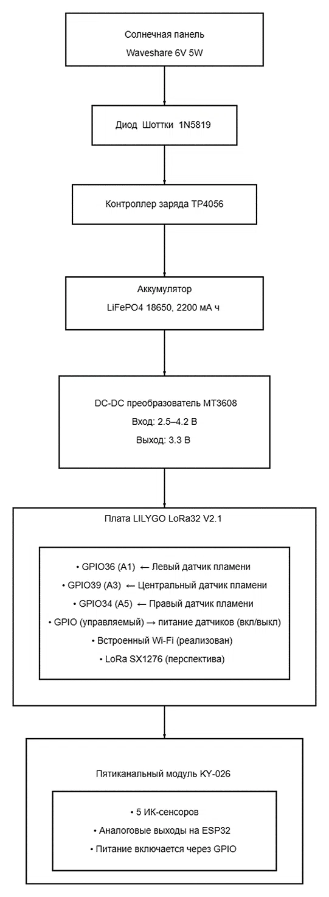
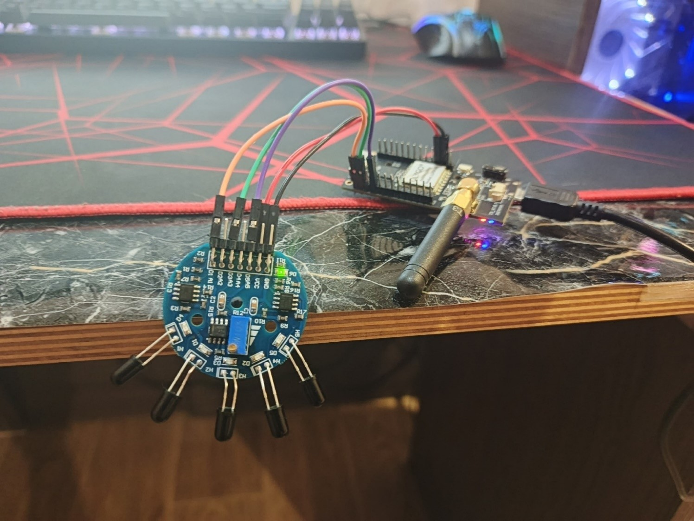
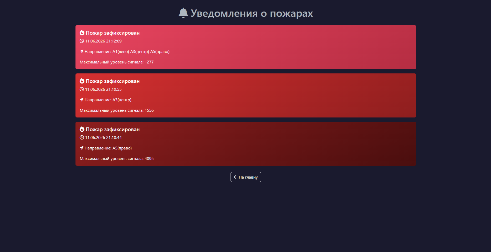

# Автономный пожарно-охранный датчик с веб-мониторингом

Дипломный проект (ВКР), реализующий систему раннего обнаружения открытого пламени на базе технологии IoT.

##  Стек технологий
*   **Аппаратная часть:** ESP32 (LILYGO LoRa32), ИК-датчики пламени KY-026.
*   **Прошивка:** C++ (Arduino IDE).
*   **Backend:** Python, Django, PostgreSQL, Nginx, Gunicorn.
*   **Frontend:** HTML, CSS (Bootstrap 5), JavaScript (AJAX).

##  Архитектура системы
Ниже представлена структурная схема разработанного устройства. Система включает в себя модуль автономного питания (солнечная панель, контроллер заряда, аккумулятор) и микроконтроллер ESP32, опрашивающий ИК-датчики пламени.

##  Основные возможности
*   Обнаружение открытого пламени с определением направления (левый/центральный/правый сенсор).
*   Энергоэффективный алгоритм: средний ток в режиме ожидания — 316 мкА (автономность до 6 месяцев).
*   Передача данных по Wi-Fi на удаленный сервер.
*   Веб-интерфейс с динамическим обновлением (AJAX) и страницей истории тревог.

##  Внешний вид и веб-интерфейс
Слева — собранный прототип на базе ESP32 и пятиканального модуля KY-026. Справа — веб-интерфейс системы в момент фиксации тревоги (цвет карточки меняется на красный, отображается направление возгорания).

  
  

В папке backend представлены основные файлы приложения Django (модели, представления). Полная конфигурация проекта разворачивалась на VPS
